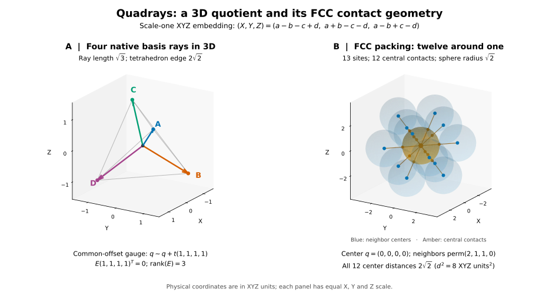
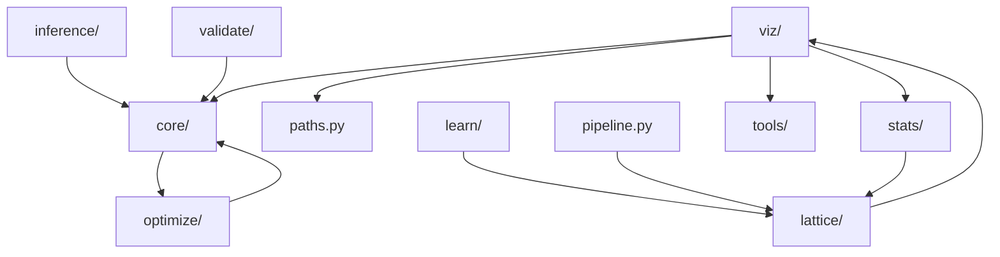

# QuadMath: Quadray Mathematics, Lattice Methods and Manuscript Tools

<p align="center">
  <a href="https://github.com/docxology/QuadMath/actions/workflows/verify.yml"></a>
  <a href="https://doi.org/10.5281/zenodo.16887791"></a>
  <a href="LICENSE"></a>
  
</p>

QuadMath combines an importable Python library, canonical mathematical chapters,
Lean models and source-checkout tools for figures and PDFs. Physical quadrays
are common-offset equivalence classes of four coordinates with rank-three
geometry, not four independent Euclidean axes.

**Repository:** [docxology/QuadMath](https://github.com/docxology/QuadMath) ·
**License:** [Apache-2.0](LICENSE) ·
**Manuscript DOI:** [10.5281/zenodo.16887791](https://zenodo.org/records/16887791)

## Rank-Three Quadrays and FCC Contact Geometry



Generated by the [quadray abstract producer](quadmath/scripts/graphical_abstract_quadray.py).
See [figure destinations and reproduction](#figure-and-manuscript-generation).

## Status & Next Actions

This checkout prepares QuadMath **0.7.0**; release availability and assets belong
to [GitHub releases](https://github.com/docxology/QuadMath/releases), with current
verification in [workflow runs](https://github.com/docxology/QuadMath/actions).
The version-1 manuscript archived on Zenodo and the `0.6.0` package release
remain historical artifacts; a fresh render does not reproduce the archived
PDF or change its DOI. See the [release notes](CHANGELOG.md),
[manuscript status](docs/MANUSCRIPT_STATUS.md) and [backlog](TODO.md).
Test counts and coverage results belong to dated run receipts, not permanent
claims about this checkout.

## Quick Start

Run commands from the repository root. The scientific workflow uses Python 3.13
explicitly; the repository's `.python-version` pin is unchanged.

```bash
git clone https://github.com/docxology/QuadMath.git
cd QuadMath
uv sync --python 3.13
uv run --python 3.13 python -c "from quadmath import Quadray; print(Quadray(3, 2, 2, 1).normalize())"
```

For an isolated, headless figure recipe that does not touch tracked outputs:

```bash
export QUADMATH_OUTPUT_DIR="$(mktemp -d)/quadmath-results"
MPLBACKEND=Agg uv run --python 3.13 python quadmath/scripts/stats_gallery.py
```

The output override applies to Python path helpers and cooperating generators,
not the shell PDF renderer. See [Figure and Manuscript Generation](#figure-and-manuscript-generation).

### Installed package

The distribution name is `quadmath-project`; the import name is `quadmath`.
Wheels include `src/quadmath`, not the checkout's manuscript scripts or Lean tree.
Use `QUADMATH_OUTPUT_DIR` for installed plotting code: without it, output helpers
search for a repository root and can raise outside a checkout. Development
source and released wheels can expose different APIs; consult the corresponding
[API glossary](quadmath/markdown/10_symbols_glossary.md).

## Synergetics suite

QuadMath supplies mathematical specification, exact determinants, lattice
methods and Lean models. Companion projects are
[symergetics](https://github.com/docxology/symergetics) for rational geometry and
research workflows, and [QuadCraft](https://github.com/docxology/QuadCraft) for
interactive/native/browser applications. They are not production dependencies
of this package.

The [suite interoperability guide](https://github.com/docxology/symergetics/blob/main/docs/synergetics-suite.md)
and its [executable example](https://github.com/docxology/symergetics/blob/main/examples/suite_interoperability.py)
cover gauge equivalence, orientation, units and different inverse rules.
Do not interchange default embeddings or assume all native tetra-volumes are integers.

## Project Structure

| Path | Responsibility | Start here |
|---|---|---|
| `src/quadmath/` | Runtime coordinates, exact/rational primitives, fields, dynamics, evaluation, statistics and plotting | [Module guide](src/README.md) |
| `tests/` | Numerical, resource-lifecycle and orchestration regression tests | [Test guide](tests/README.md) |
| `quadmath/markdown/` | Canonical mathematical chapters | [Specification](SPEC.md), [methods](quadmath/markdown/03_quadray_methods.md) |
| `quadmath/scripts/` | Figure/data orchestration, API glossary and PDF tools | [Build guide](quadmath/README.md) |
| `quadmath/output/` | Generated, partly tracked artifacts; preserve user work | [Output policy](WORKFLOW.md#output-management) |
| `docs/manuscript/` | Scripted template-layout projection, not an independent editing source | [Projection guide](docs/manuscript/README.md) |
| `docs/` | Operational navigation and focused learning/analysis/Lean guides | [Documentation index](docs/README.md) |
| `lean/` | Handwritten Lean 4 integer quotient, distance, volume and shell models | [Proof scope](docs/lean/README.md) |

### Package map

Generated on 2026-11-12 from the `import` statements under `src/quadmath/`. An arrow from A to B means code in A imports B; arrows already implied by a longer path are left out, so the picture shows layering rather than every edge.



## Mathematical and learning entry points

- [Quadray methods](quadmath/markdown/03_quadray_methods.md) and
  [conversions](quadmath/markdown/14_conversions_spec.md): gauge, metric, affine,
  oriented and volume contracts.
- [Field learning](quadmath/markdown/11_ivm_field_learning.md): soft regularized
  fitting versus hard-boundary harmonic extension.
- [Dynamics](quadmath/markdown/12_ivm_dynamics.md): symmetric-normalized heat,
  conservative concentration transport and integer rounded averaging are distinct laws.
- [Evaluation](quadmath/markdown/15_learning_evaluation.md): validation-fold
  selection, temporal continuation and tabular baselines. Random site folds
  do not guarantee spatially independent generalization.
- [Benchmarks/statistics](quadmath/markdown/17_benchmarks_statistics.md): seeded
  workloads and inference; elapsed timings remain machine-dependent.

## Figure and Manuscript Generation

Python renderers are library operations. Scripts select examples, call them and
print paths. `make_all_figures.py` runs its explicit generator list and writes
`data/figure_manifest.txt` under the configured output root. It is not a test suite.

The canonical graphical abstract is emitted by
`quadmath/scripts/graphical_abstract_quadray.py`; its PNG remains
`figures/graphical_abstract_quadray.png`, with an SVG companion. The panels
identify the scale-one basis and actual FCC 12-contact neighborhood rather
than treating four basis vectors as a packing neighborhood.

### Build (PDF)

The shell renderer requires `pandoc`, `xelatex`, `fontconfig` (`fc-list`),
DejaVu Serif and DejaVu Sans Mono. On macOS install Pandoc, TeX Live/MacTeX,
fontconfig and DejaVu; on Debian/Ubuntu install `pandoc texlive-xetex
texlive-fonts-recommended fontconfig fonts-dejavu`.

```bash
# Deliberately writes checkout artifacts and updates the canonical API glossary.
# Run in a separate checkout if those writes must be isolated.
unset QUADMATH_OUTPUT_DIR
UV_PYTHON=3.13 bash quadmath/scripts/render_pdf.sh
```

It generates figures (unless `--skip-figures`), refreshes the glossary, runs
strict manuscript validation, then builds individual/combined PDF and TeX.
It does **not** run pytest, coverage or Lean. PDF/TeX remain fixed under
`quadmath/output/`; setting `QUADMATH_OUTPUT_DIR` does not redirect them and
can separate new figures from the paths expected by the manuscript.

## Development Workflow

[WORKFLOW.md](WORKFLOW.md) separates runtime changes, documentation checks,
rendering and integration. [ARCHITECTURE.md](ARCHITECTURE.md) describes boundaries.
For an integration owner explicitly running verification:

```bash
PYTEST_DISABLE_PLUGIN_AUTOLOAD=1 uv run --python 3.13 coverage run -m pytest -q
uv run --python 3.13 coverage report
```

The configured coverage floor is a gate, not proof of every mathematical claim.
During delegated implementation, defer builds/tests/lint/formatters to the
integration owner and preserve generated files. Never clean outputs merely
because they can theoretically be regenerated.

## Contributing

Use a feature branch, read [agent guidance](AGENTS.md), add behavior-level
regressions for changed consumer contracts, and update affected chapters or
operational guides. Preserve explicit equation/code anchors. Record only
checks actually exercised and review figure labels, units and legibility in
addition to successful saves.

## Citation

```bibtex
@software{quadmath2025,
  title={QuadMath: Analytical Review of Quadray Coordinates (4D)},
  author={docxology},
  year={2025},
  url={https://github.com/docxology/QuadMath},
  doi={10.5281/zenodo.16887791},
  license={Apache-2.0}
}
```
