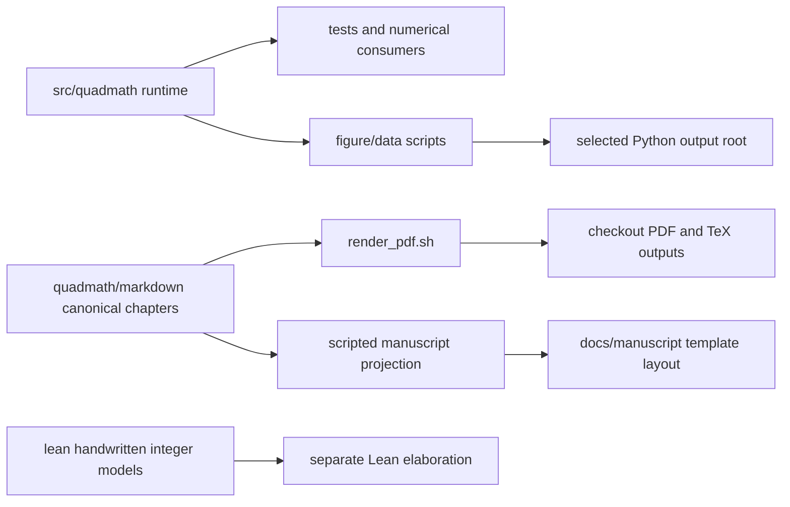

# QuadMath Repository Tour: Runtime, Chapters, Projections and Proof Models

The [root guide](../README.md) covers installation and suite context; this tour
shows where a change belongs. For mathematical conventions use
[SPEC.md](../SPEC.md), not a separate operational derivation.

## Runtime versus checkout tools

`src/quadmath/` is the packaged Python library: core exact/rational geometry,
lattice construction/search, field/dynamics methods, optimization, information
helpers, evaluation, statistics, reusable visualization and utility modules.
[The source guide](../src/README.md) maps modules to canonical chapters.
`tests/` mirrors runtime responsibilities and adds checkout-tool regressions;
[the test guide](../tests/README.md) separates configuration from measured status.

`quadmath/scripts/` selects example inputs and orchestrates saved figures,
API glossary generation, Markdown validation and PDF/TeX conversion. These scripts
are not part of an installed wheel. `run_all.sh` runs suite/coverage plus figures
and source checks by default; `--with-pdf` explicitly adds PDF rendering.
Neither wrapper elaborates Lean or replaces visual/semantic review.

## Document flow

Only the marked API-glossary block is regenerated from Python. Other prose
requires source-informed maintenance. The template projection has a
[separate guide](manuscript/README.md) and [status](MANUSCRIPT_STATUS.md); do not
hand-edit copied chapters or figures. A fresh render is not the historical
version-1 PDF archived on [Zenodo](https://zenodo.org/records/16887791).

## Output policy

Python path helpers honor `QUADMATH_OUTPUT_DIR`, enabling isolated figures and
wheel consumers without repository lookup. The shell renderer fixes PDF/TeX
paths under `quadmath/output/` and updates the canonical glossary. Its cleanup
script removes the fixed checkout output tree. Generated files can contain user
work and are partly tracked: never clean them automatically. See
[workflow output management](../WORKFLOW.md#output-management).

## Focused operational reading

1. [Development checks](development/README.md): separate evidence gates and ownership.
2. [Learning operations](learning/README.md): soft versus hard boundaries,
   transport laws and validation-versus-test distinctions.
3. [Analysis operations](analysis/README.md): timings, statistical assumptions
   and illustrative plotting data.
4. [Lean scope](lean/README.md): quotient/distance/volume declarations, finite
   computations, trust and unproved universal counts.
5. [Manuscript tools](../quadmath/README.md): figures, dependencies and PDF isolation.

Return to the [documentation index](README.md) or
[architecture](../ARCHITECTURE.md).
