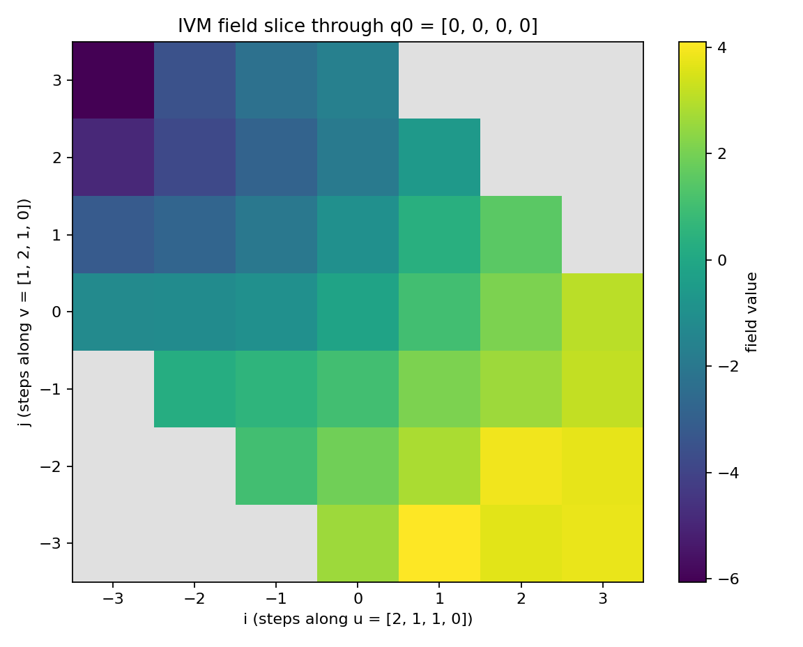

# Lattice Visualization Gallery

## Overview

The IVM rendering surface is `vis_lattice.py`: `shell_scatter`,
`field_slice`, `dynamics_strip`, `boundary_comparison` and
`dynamics_comparison` compose on caller-owned matplotlib axes. Only
`gallery` creates figures, writing three deterministic PNGs. The thin
command-line entry `quadmath/scripts/lattice_gallery.py` sets a headless
backend, delegates to `gallery`, and prints the three output paths in
manifest order. Seeded boundary noise and initial fields make repeated
runs reproducible.

## Frequency shells

`shell_scatter(ax, sites, k)` embeds the graph shell `k` from
`omni_numbering.generate_shell`. For \(k>0\) its cardinality is
\(10k^2+2\); shell zero is the origin. The label includes both the graph
shell index and site count. A graph-shell radius counts neighbor moves:
it is **not** an XYZ Euclidean radius. With `axis_hints`, dashed rays
mark the four embedding columns, the tetrahedral quadray directions.
`shell_scatter` and `dynamics_strip` enforce equal physical XYZ metric
aspect using the shared `set_axes_equal` helper.

## Lattice-plane slices

`field_slice(ax, field, sites, plane)` renders a scalar
`ivm_field.IVMField` as a heatmap restricted to a lattice plane.  A plane
is parametrized by an origin \(q_0\) and two independent integer
translation vectors \(u\), \(v\) — by default two of the twelve IVM
neighbor moves, both permutations of \((2,1,1,0)\) — and its points are

\begin{equation}
\label{eq:vis-plane}
q(i, j) \;=\; \operatorname{normalize}\!\big(q_0 + i\,u + j\,v\big),
\qquad (i, j) \in \mathbb{Z}^2 ,
\end{equation}

with `normalize` the canonical quadray representative. Membership means
\(q-q_0=i u+j v+m(1,1,1,1)\) for **integer** \(i,j,m\).
The implementation first subtracts each vector's fourth component,
removing the common-offset gauge. A nonzero two-by-two minor of the
resulting three-by-two integer basis gives Cramer's numerators;
divisibility and all three quotient equations are checked with Python
integers. Independence is required **modulo the common-offset direction**,
not merely in raw four-space. Arbitrarily large integer gauges and
ill-conditioned integer bases therefore do not pass through a floating
rank test or least-squares membership solve.

Each occupied cell has unit width at its actual integer index. Missing
rows, columns and cells remain neutral gaps rather than being stretched
into observations. Consecutive absent indices are represented by one
masked band. To avoid a quadratic Cartesian-product allocation, large
sparse products use a `PolyCollection` of occupied cells instead of a
`QuadMesh`; storage is bounded linearly in sample count, independent of
empty index extent. `field_slice` returns either artist type. These axes
are lattice **indices**, not orthonormal physical coordinates.

For huge in-plane offsets, exact integer local origins are subtracted
before float display conversion. The labels explicitly state
`i - (origin)` / `j - (origin)` and the returned artist records the exact
pair as `plane_index_origin`. Small separations are retained without
claiming that arbitrary huge absolute indices are representable floats.
An optional shared `norm` supports honest cross-panel color comparison;
an identically zero field maps to the colormap midpoint.

## Hard boundary versus soft fitting

`boundary_comparison(axs, hard, soft, boundary_sites, boundary_values)`
uses four caller-owned 2D axes: two matched-color plane slices,
prescribed-versus-fitted boundary values, and absolute interior residuals
\(|Lf|\). It returns the slice artists, boundary-error arrays and interior
residual arrays derived from the supplied model fields.

The gallery supplies the same noisy, spatially varying observations to
`IVMField.harmonic_extension` and `IVMField.learn` on the **graph-shell
radius-3 ball (147 sites)**. Boundary sites are those with fewer than
twelve in-domain neighbors. Hard extension pins those values and solves
\(L_{UU}f_U=-L_{UB}f_B\), so the interior is harmonic up to floating solver
residual. Soft learning instead solves its regularized data-fit system
(`lam=0.4`, kernel width `1.5`); it need not interpolate observations or
have a harmonic interior. Neither fit is labeled exact recovery of an
unknown truth. See [Static IVM Field Learning](11_ivm_field_learning.md).

## Dynamics and finite-boundary diagnostics

`dynamics_strip(axs, trajectory, t_indices, norm=None)` renders selected
snapshots on a symmetric color scale shared across panels, or an explicit
shared `Normalize` supplied by the caller. A zero trajectory uses
\([-1,1]\), putting zero at the neutral midpoint rather than a colormap
endpoint.

`dynamics_comparison(axs, conservative, normalized)` takes six axes:
three 3D axes for graph degree and the two final fields, followed by
three 2D axes for changes in conserved quantities, the trajectories'
recorded `sos`, and distance from each stationary projection. Both
trajectories must share the same graph, initial state and horizon.
Returned diagnostics include componentwise stationary fields and
residual norms, not an ordinary-mean interpretation of normalized heat.

The gallery compares forty updates at \(\alpha=0.45\) on the
**Euclidean-radius-3 domain (13 sites)**. Conservative transport uses the
unnormalized Laplacian with the model's degree-bound step size, preserves
\(\sum_i u_i\), and has a constant stationary field on each connected
component. Symmetric-normalized heat uses
\(S=D^{-1/2}AD^{-1/2}\); its connected nonisolated stationary mode is
\(\sqrt{d}\), with conserved projection \(\sqrt{d}^{\,T}u\), generally
**not** conserved ordinary sum. Isolated sites retain their concentration
under conservative transport but have zero stationary projection for
positive-coupling normalized heat. The degree panel exposes the finite
boundary that produces this distinction. Stationary references are
computed separately for every connected component.

## Deterministic animations and gallery plots {#sec:animation_frames}

Where the primitives above compose panels inside caller-owned figures, the module `src/quadmath/viz/animations.py` renders frame-based animations that own their pixels: each renderer returns a list of `Frame` objects — the frozen `dataclass` `Frame` in that file pairs a 2D `numpy` array with a human-readable `title`, and its `__post_init__` validation admits only `uint8` arrays (raw gray levels) or float arrays with every value in \([0, 1]\), rejecting anything that is not 2D, is of another dtype, or drifts outside the unit interval.  No matplotlib is involved at frame level and no RNG or wall-clock input exists (except the explicit `seed` of `diffusion_frames`), so identical arguments yield byte-identical frames.  All three renderers share one fixed-camera convention: sites are embedded in \(R^3\) via `DEFAULT_EMBEDDING` and viewed by an orthographic camera looking down \(+z\) — each point \((x,y,z)\) projects to \((x,y)\) on a `GRID_SIZE` \(=48\) square grid whose extent is \([-8, 8]\) (module constant `_HALF_EXTENT`, sized to cover a radius-3 IVM ball of embedded norm \(6\) with margin even while pulsing), the vertical axis flipped so \(+y\) points up, colliding points resolved by maximum brightness, and out-of-window points clamped to the border pixel.

`simplex_frames(q0, q1, n=16)` animates a quaternion-slerp rotation of the radius-1 ball: the two unit quaternions \(q_0\), \(q_1\) (validated to four components of unit norm) are interpolated on the shortest arc — sign-flipping \(q_1\) when their dot product is negative, using the Shoemaker spherical formula \(q(t) = \sin((1-t)\theta)\,q_0 / \sin\theta + \sin(t\theta)\,q_1 / \sin\theta\), and falling back to normalized linear interpolation when the inputs are nearly parallel — and at each \(t = i/(n-1)\) the 13 lattice sites of `ball_sites` radius 1 are rotated by \(q(t)\), projected onto the 48×48 grid, and shaded by radial shell, with origin brightness \(1.0\) and the outermost shell never dimmer than \(0.25\) so nothing renders invisible.

`lattice_frames(shells=3, n=12)` renders a pulsing IVM lattice ball: the radius-`shells` ball from `ball_sites` (147 sites at the default radius 3) has its embedded coordinates scaled per frame by the deterministic pulse \(1 + 0.25\sin(2\pi i/n)\) over one full growth-and-contraction cycle, while brightness per site stays the fixed radial-shell shading — brightest at the center, decaying linearly in shell index, outermost shell at \(0.25\) — so the pulse animates geometry, not shading.

`diffusion_frames(n_steps=12, seed=0)` seeds one-hot heat on the radius-3 ball and diffuses it over the IVM neighbor graph: the 147 ball sites become a graph in which two sites are adjacent iff their difference normalizes to one of the twelve `IVM_NEIGHBOR_STEPS`, a `numpy.random.default_rng(seed)` draw selects the source site deterministically, and each explicit update applies \(u \leftarrow u + \alpha\,(\text{mean of graph neighbors} - u)\) with \(\alpha = 0.25\) (stable below \(0.5\)) and values clipped at zero.  Each frame is normalized by dividing by its (always positive) maximum heat, giving float values in \([0, 1]\); because heat only spreads to graph neighbors, the set of heated sites grows monotonically across frames.

The companion module `src/quadmath/viz/plots.py` supplies standalone figure builders for diagnostics that do not belong to any gallery: `plot_loss_history` draws a training loss sequence as a marker line over its iteration index, `plot_shell_growth` plots the IVM shell cardinalities — the cuboctahedral numbers \(10k^2+2\) produced by `shell_cardinalities` in `src/quadmath/lattice/ivm_field.py` — versus shell index, `plot_error_histogram` histograms error values with a dashed vertical mean line, and `plot_lattice_shell_3d` scatters the sites of one shell (`shell_sites`, embedded via `DEFAULT_EMBEDDING`) in 3D with equal-aspect axes.  Unlike the axes-composing primitives of `vis_lattice`, each owns a fixed-size figure (6.4×4.8 inches at 160 dpi), applies a fixed style, and on `save=True` writes its PNG into `quadmath/output/figures/` via `quadmath.paths.get_figure_dir`, returning the output path (empty string when the caller keeps the figure).  All four are input-agnostic and seed-free: inputs are plain sequences or shell indices, styling is fixed, and no randomness or wall-clock time enters, so runs stay deterministic headless (`MPLBACKEND=Agg`).

`frames_to_gif(frames, out_path, fps=8, scale=8)` assembles a frame sequence into an animated GIF: float frames are quantized to `uint8` gray levels by rounding \(255\,v\), each frame is upscaled by the integer factor `scale` with nearest-neighbor resampling, and the sequence is saved with per-frame duration \(1000\,/\,\texttt{fps}\) milliseconds and infinite looping.  PIL is imported lazily inside the function (Pillow stays optional at import time), and because the PIL GIF encoder is deterministic and embeds no timestamps, identical `(frames, fps, scale)` inputs render byte-identical GIF files — the same byte-stability contract the PNG gallery asserts.

`frames_strip(frames, out_path=None, labels=None, save=True)` renders the print still-counterpart of `frames_to_gif`: a single-row matplotlib strip with one grayscale `imshow` panel per `Frame`, figure width scaling with the panel count while the height stays one panel plus the title band, each panel pinned to the unit brightness interval (`vmin = 0`, `vmax = 1`; `uint8` frames are first mapped by \(v/255\), so both `Frame` dtypes share the GIF's gray-level convention), per-panel titles taken from `labels` or, by default, from each frame's own `title`, and axes switched off with zero inter-panel spacing so consecutive panels butt together.  Matplotlib is imported lazily inside the function (the module stays matplotlib-free at import time), and saving follows the `plots.py` convention: a bare `out_path` name is written into `quadmath/output/figures/` via `quadmath.paths.get_figure_dir`, a path carrying a directory component is used verbatim, and the returned string is the written path (`""` when `save` is off or no name is given).  An empty `frames` sequence or a `labels` length mismatch raises `ValueError`; the render has no RNG and no wall-clock input, so identical inputs give byte-identical PNGs — the test suite asserts the byte stability, the full \([0, 1]\) grayscale excursion, the uint8/float equivalence, and the panel-count scaling.

![**Three animation stills in one strip.** Single-row `frames_strip` composition of one evenly spaced still from each 6-frame animation: left, the pulsing radius-2 IVM ball sampled at the quarter-pulse fraction (`lattice_frames`, radial-shell brightness, brightest at the center); center, the quaternion-slerp rotation of the radius-1 ball in the midpoint region of the arc (\(t = 0.4\) on the way from the identity to a 90-degree rotation about \(z\), `simplex_frames`); right, the final state of seeded heat diffusion on the radius-3 ball (`diffusion_frames`, brightness normalized by the frame's maximum heat).  All panels are 48×48 orthographic projections under the fixed \(+z\) camera with brightness in \([0, 1]\); reproduced with `uv run python quadmath/scripts/animation_stills.py`.](../output/figures/animation_frames_strip.png)

The command-line surface is `quadmath/scripts/animation_gallery.py` — a thin orchestrator in the `quadmath/scripts/AGENTS.md` contract that sets the headless `Agg` backend and renders three GIFs via `frames_to_gif`: `animation_lattice.gif` (pulsing radius-3 ball, 12 frames), `animation_simplex.gif` (slerp from the identity to a 90-degree rotation about the \(x\) axis, 16 frames), and `animation_diffusion.gif` (12 diffusion steps from seed 0), writing each into `quadmath/output/figures/` and printing each path on its own line.  The script is registered in `quadmath/scripts/make_all_figures.py` alongside the other galleries, so the manifest contract of the Overview applies unchanged: only path lines on stdout, byte-identical re-renders for identical inputs.  The companion `quadmath/scripts/animation_stills.py` follows the same thin-orchestrator contract for print stills: it renders the three 6-frame sequences of the module — `lattice_frames` at radius 2, `simplex_frames` from the identity to a 90-degree rotation about \(z\) with the endpoint quaternion derived from `rotate_about_axis`, and `diffusion_frames` at seed 0 — samples each at an evenly spaced fraction (quarter-pulse, slerp midpoint region, final diffusion step), composes the three stills with `frames_strip` into `animation_frames_strip.png`, and prints the written path on its own line.

## Reproducibility and test contract

- `gallery(paths_out_dir, seed=12)` writes exactly the three files
  `vis_gallery_shell.png`, `vis_gallery_field.png`,
  `vis_gallery_dynamics.png` (module constant `GALLERY_FILES`, in that
  order) into `paths_out_dir`, creating it when missing, and returns their
  paths.  Every panel is fully seeded, and the PNGs carry no timestamp
  metadata: the test suite asserts byte-identical re-renders for a fixed
  seed.
- Tests: `tests/unit/viz/test_vis_lattice.py` covers exact quotient rank,
  gauge invariance, integer divisibility, ill-conditioned bases, sparse
  gap placement and bounded storage, huge-offset local display, zero
  normalization, equal metric aspect, model-derived boundary and dynamics
  diagnostics, and byte-level gallery reproducibility. Run the focused
  module with `PYTEST_DISABLE_PLUGIN_AUTOLOAD=1 python -m pytest
  tests/unit/viz/test_vis_lattice.py -q` in the supported environment.
- Tests: `tests/unit/viz/test_animations.py` covers the frame module
  (`Frame` validation, the three renderers, `frames_to_gif`) and the strip
  renderer — `frames_strip` label and emptiness validation, byte-identical
  re-renders in temporary directories, uint8/float equivalence, the full
  grayscale excursion, and panel-count scaling — headless via
  `MPLBACKEND=Agg` (set in `tests/conftest.py`).
- Figure regeneration:
  `uv run python quadmath/scripts/lattice_gallery.py` (the script sets
  `MPLBACKEND=Agg` itself); stdout is exactly the three written paths.
- Still-strip regeneration:
  `uv run python quadmath/scripts/animation_stills.py` (the script sets
  `MPLBACKEND=Agg` itself); stdout is exactly the one written strip path,
  `quadmath/output/figures/animation_frames_strip.png`.
- Markdown: `uv run python quadmath/scripts/validate_markdown.py`.

## Cross-references

- Site geometry, normalization, and the embedding:
  [Quadray Methods](03_quadray_methods.md).
- Shell enumeration and nearest-site search:
  [Lattice Tooling](13_lattice_tooling.md).
- The sliced learner: [Static IVM Field
  Learning](11_ivm_field_learning.md).
- The stripped dynamics: [Dynamics and Learning on the IVM
  Lattice](12_ivm_dynamics.md).
