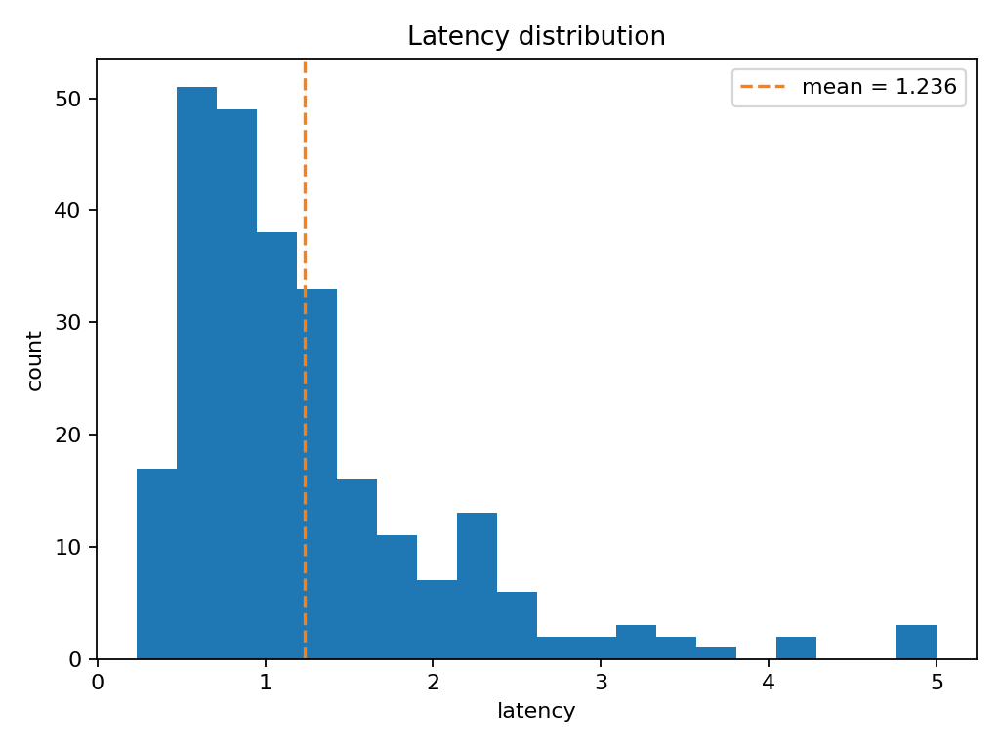
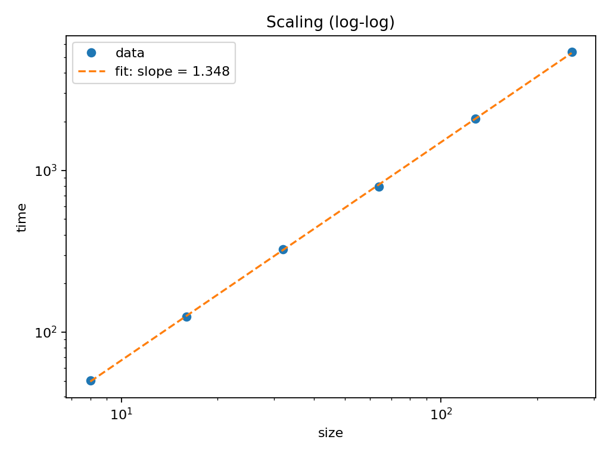
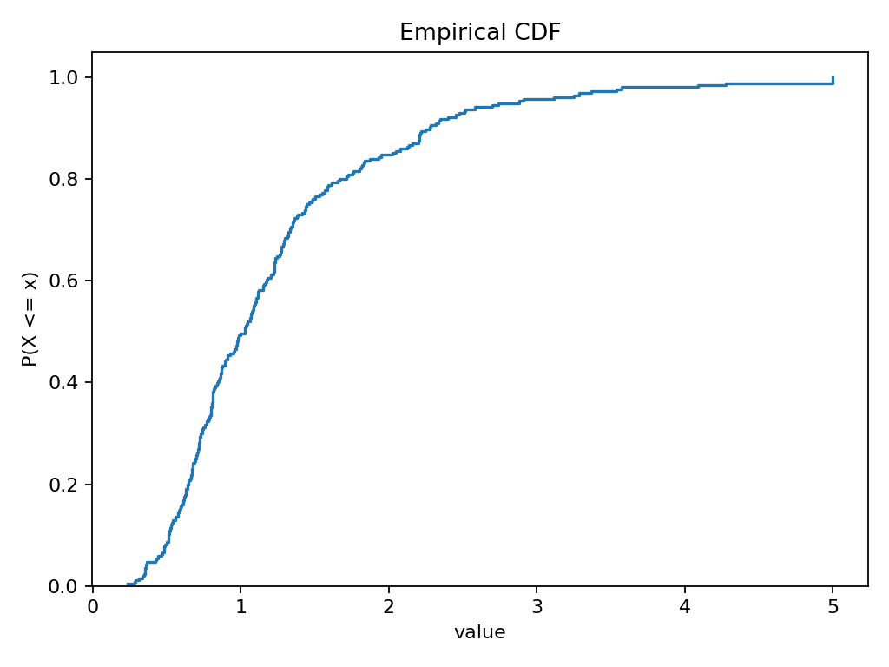

# Statistical Graphics: Seeded Samples, Inference Bounds, and Scaling Fits

## Reusable axes primitives and explicitly synthetic examples

[The statistical graphics module](../../src/quadmath/viz/vis_stats.py) owns
`plot_latency_hist`, `plot_scaling_loglog`, `plot_ci_bars` and `plot_ecdf`.
Each accepts nonempty, real, finite one-dimensional data. Caller axes remain
caller-owned. Without axes, a successful call transfers its new figure to the
caller; a drawing failure closes only a figure created by that call. Invalid
data is rejected before allocating a figure.

[The gallery entry point](../../quadmath/scripts/stats_gallery.py) selects seed 32 and prints
four output paths for the manuscript manifest. Its examples are generated data,
**not measurements of package routines or evidence of a performance advantage**.
The composer reuses the shared statistical fit and bootstrap methods rather
than inventing confidence widths.

## Histogram counts and a representable sample mean

`plot_latency_hist(times, ax=None, *, bins=20, title=...)` displays sample counts
and their mean. Units belong to the caller: a measured sample from
[`time_callable`](17_benchmarks_statistics.md) is in seconds, but arbitrary
numbers do not become timings merely by being plotted.

The gallery uses 256 seeded lognormal draws with log mean 0 and log standard
deviation 0.6, clipped to `[0.05, 5.0]`. Its axis explicitly calls these
**synthetic latency seconds**. The shared `sample_mean` uses compensated
summation, with exact represented-value accumulation only if the intermediate
sum overflows; it preserves cancellation residuals as well as finite means.



## Shared log-space regression without overflowing intermediate powers

`plot_scaling_loglog(sizes, times, ax=None, *, title=...)` delegates to
[`scaling_fit` and `scaling_predict`](17_benchmarks_statistics.md) for a shared
ordinary least-squares model. Sizes and times must align and be positive,
finite vectors with at least two distinct represented sizes. The kernel
centers/scales log ratios relative to a paired observation at the maximum
runtime, using `log1p` near the reference to retain adjacent-size differences.

Prediction uses the relative fitted offset and binary-exponent decomposition,
not `exp(intercept + slope * log(size))` or
`exp(intercept) * size**slope`. A residual-derived offset keeps the noisy fit
from being forced through the reference observation. The global intercept is
for reporting only. Curves are ordered by size; unrepresentable positive
predictions raise rather than silently disappearing.
The legend reports the fitted exponent and log-space $R^2$, which is undefined
when all observed times are equal.

The example uses sizes `{8,16,32,64,128,256}` and a planted power law
$t = 3 n^{1.35}(1+\varepsilon)$ with seeded 2% normal relative noise. It is an
illustration, not a measurement or proof of an algorithm's asymptotic complexity.



## Computed bootstrap intervals and independent point estimates

`plot_ci_bars(labels, means, lows, highs, ax=None, *, title=...)` displays the
supplied estimates and finite interval endpoints. It does not infer confidence
levels. A point estimate need not lie inside its interval: bounds are drawn
independently rather than being forced into nonnegative error lengths around
that estimate. Reversed bounds and misaligned inputs are rejected before drawing.

The gallery draws independent normal samples of sizes **16, 64 and 256**, with
generating mean 1.5 and standard deviation 0.4. For each sample it computes a
mean and a **nominal 95% percentile-bootstrap interval** using 2,000 seeded
resamples through the shared `bootstrap_ci` with its `sample_mean` default.
The generating population mean is
shown as a separate reference, not substituted for the observed estimate.
A particular interval can miss the generating value; its confidence level is
not a guarantee about one realization. These are not timings for API-name labels.

Overlap of two individual intervals is not equivalent to a specified test of
their difference. Sampling design, dependence and the comparison target matter;
see [statistical methods and assumptions](17_benchmarks_statistics.md).


## Right-continuous ECDF jumps, ties, and singleton observations

`plot_ecdf(values, ax=None, *, title=...)` renders the empirical distribution

\begin{equation}
\label{eq:vis-ecdf}
\hat{F}(t) \;=\; \frac{1}{n}\sum_{i=1}^{n}
\mathbf{1}\{t_i \le t\},
\end{equation}

on the observed sample range. Equal observations contribute one combined jump.
The path includes zero at the smallest observation, so a one-sample ECDF still
shows its full zero-to-one jump rather than an invisible lone point. No density,
interpolation between probability jumps, or future-latency guarantee is inferred.
NumPy's interpolated percentile summaries need not coincide with inverse-step
quantiles.



## Reproducing numerical inputs and checking observable behavior

Run from repository root with an isolated output directory:

```bash
export QUADMATH_OUTPUT_DIR="$(mktemp -d)/quadmath-results"
MPLBACKEND=Agg uv run --python 3.13 python quadmath/scripts/stats_gallery.py
MPLBACKEND=Agg uv run --python 3.13 python quadmath/scripts/stats_diagnostics_gallery.py
```

The first command emits `stats_gallery_latency.png`, `stats_gallery_scaling.png`,
`stats_gallery_ci.png` and `stats_gallery_ecdf.png`. The second compares bootstrap
and normal-approximation jackknife intervals on two explicitly synthetic groups,
with their generating means identified separately.

A fixed seed reproduces numerical inputs within the declared numerical
implementation. Fonts, plotting/encoding versions and backend settings can
change media bytes; encoded equality is not a portable mathematical guarantee.
Regression coverage targets actual histogram counts, interval geometry,
extreme-size fitted predictions, tied/singleton ECDFs, input boundaries and
figure ownership, not incidental wording or copied filename inventories.

[Benchmark and inference methods](17_benchmarks_statistics.md) own numerical
assumptions. [The lattice gallery](16_lattice_gallery.md) owns coordinate/field
visualizations. [Figure orchestration](../../quadmath/scripts/README.md) owns output and
manifest conventions; Python output redirection is not a shell-PDF build sandbox.
